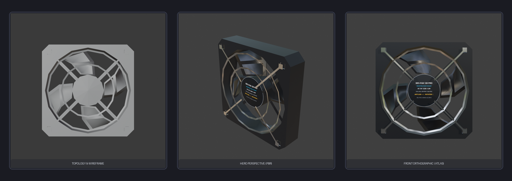
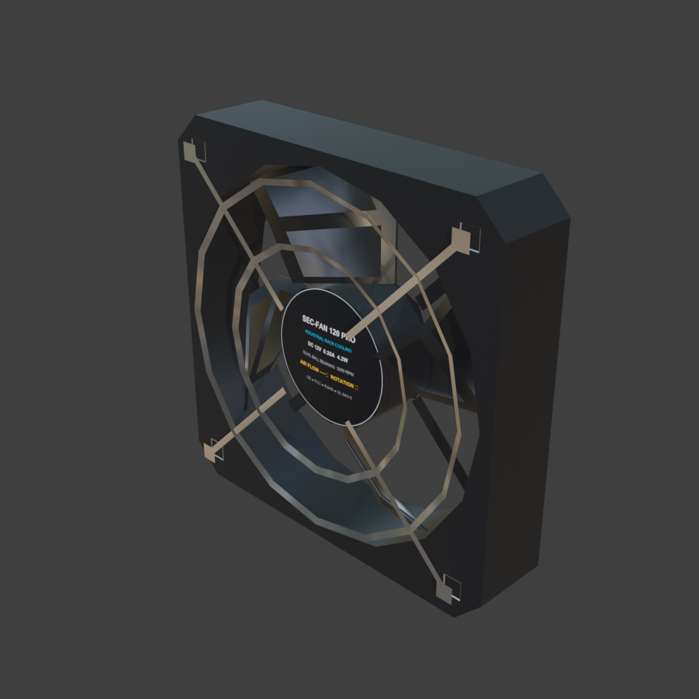
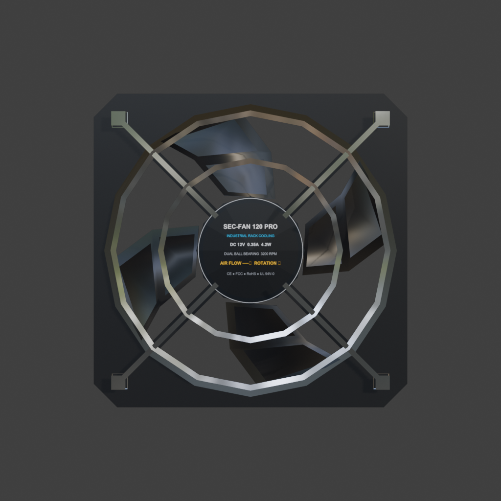

# 🔒 Security & CCTV Low-Poly 3D Asset Pack (75 Game-Ready Assets)

[](LICENSE)
[](https://www.blender.org)
[](https://unity.com)
[](https://www.unrealengine.com)
[](https://godotengine.org)
[-success.svg)]()
[-blue.svg)]()

> A production-grade, highly optimized library of **75 industrial surveillance, physical security, access control, server rack, and cable management 3D assets**. Built with strict game development constraints, verified in Blender 5.2 LTS, and engineered for plug-and-play integration into **Unity**, **Unreal Engine 5**, and **Godot 4**.

<p align="center">
  
</p>

<p align="center">
  
  
</p>

---

## 📋 Table of Contents
- [Key Features](#-key-features)
- [Technical Specifications](#-technical-specifications)
- [Full 75-Asset Catalog](#-full-75-asset-catalog)
- [Engine Integration Guide](#-engine-integration-guide)
  - [Unity Setup](#unity-integration)
  - [Unreal Engine 5 Setup](#unreal-engine-5-integration)
  - [Godot 4 Setup](#godot-4-integration)
- [Procedural Pipeline & QA Automation](#-procedural-pipeline--qa-automation)
- [Directory Structure](#-directory-structure)
- [License](#-license)
- [Author & Credits](#-author--credits)

---

## ✨ Key Features

- **🎮 Extreme Optimization:** Total triangle count across all 75 models is **35,773 triangles** (~477 tris average per asset). Zero waste, clean topology, manifold geometry, and 100% engine-ready.
- **🎯 Interactive Dynamic Pivots:** Models with moving mechanisms feature functional pivot empties (PTZ dual-axis pan/tilt, keypads with pressable buttons, sliding rack drawers, cooling fan blades, door hinges).
- **📐 Calibrated Mounting Origins:** Every object's root origin is placed flush with its real-world mounting surface (Wall, Ceiling, 19" Rack Rail, Desktop, or Floor), eliminating positioning guesswork in level design.
- **🎨 Atlas & Palette UV Layout:** Clean material separation with emission channels for status indicator LEDs, backlit silicone buttons, and CRT/LCD screens.
- **🛠️ 100% Reproducible Python Pipeline:** Every asset contains its standalone procedural generation script (`generate_SEC_*.py`), allowing automated generation directly in headless Blender.
- **✅ Full Quality Assurance:** Automatically validated with zero non-planar n-gons, 1:1:1 scale transforms, and correct $-Z$ forward / $+Y$ up orientations.

---

## ⚙️ Technical Specifications

| Parameter | Specification |
| :--- | :--- |
| **Asset Count** | 75 Complete Assets |
| **Total Triangles** | 35,773 Tris |
| **Average Triangles** | ~477 Tris per Asset |
| **Minimum / Maximum Tris** | 48 Tris (`SEC_Alarm_Keypad_Touch`) / 5,868 Tris (`SEC_Cable_Gland_Set`) |
| **Coordinate System** | $-Z$ Forward, $+Y$ Up (Unity Native), metric scale (1.0 = 1 meter) |
| **Formats Included** | `.fbx` (Game-ready), `.blend` (Blender 5.2.0 LTS source), `.py` (Procedural scripts) |
| **Materials** | Atlas mapped (`T_Security_Atlas`, `T_Screen`, `T_Metal`), Emission supported |
| **Mesh Hierarchy** | Structured root Empty with parented sub-meshes and functional pivot empties |

---

## 📦 Full 75-Asset Catalog

### 📂 Surveillance & CCTV Cameras

| ID | Asset Name | Tris | Budget | Pivots & Functionality | Mount Point |
| :---: | :--- | :---: | :---: | :--- | :--- |
| **01** | `SEC_Camera_PTZ_Industrial` | 724 | 800 | `Swivel_Y_Pivot`, `Tilt_X_Pivot` | Universal Surface |
| **02** | `SEC_Camera_Dome_Ceiling` | 466 | 500 | `Camera_Module_Pivot` | Ceiling Mount |
| **03** | `SEC_Camera_Box_Wall` | 394 | 450 | `Bracket_Pivot` | Wall Mount |
| **26** | `SEC_Camera_Bullet_Outdoor` | 486 | 520 | `Aim_Pivot` | Door Frame / Leaf |
| **27** | `SEC_Camera_Fisheye_360` | 288 | 320 | *Static* | Universal Surface |
| **28** | `SEC_Camera_Thermal` | 438 | 480 | `Aim_Pivot` | Universal Surface |
| **29** | `SEC_Camera_LPR` | 510 | 600 | `Aim_Pivot` | Universal Surface |
| **30** | `SEC_Camera_Mini_Dome` | 291 | 300 | `Camera_Module_Pivot` | Ceiling Mount |
| **31** | `SEC_Camera_Corner_Mount` | 394 | 450 | `Aim_Pivot` | Wall Mount |
| **32** | `SEC_Camera_Concealed_Smoke` | 214 | 280 | *Static* | Universal Surface |
| **33** | `SEC_Camera_Armored` | 570 | 620 | `Aim_Pivot` | Universal Surface |

### 📂 Sensors & Perimeter Detection

| ID | Asset Name | Tris | Budget | Pivots & Functionality | Mount Point |
| :---: | :--- | :---: | :---: | :--- | :--- |
| **04** | `SEC_Sensor_PIR_Motion` | 132 | 220 | *Static* | Universal Surface |
| **05** | `SEC_Sensor_Smoke_Fire` | 232 | 250 | *Static* | Universal Surface |
| **06** | `SEC_Laser_Barrier_Emitter` | 242 | 300 | `Aim_Pivot` | Universal Surface |
| **07** | `SEC_Laser_Barrier_Receiver` | 270 | 300 | `Aim_Pivot` | Universal Surface |
| **34** | `SEC_Sensor_Glass_Break` | 172 | 240 | *Static* | Universal Surface |
| **35** | `SEC_Sensor_Door_Contact` | 176 | 180 | *Static* | Door Frame / Leaf |
| **36** | `SEC_Sensor_Vibration` | 216 | 220 | *Static* | Universal Surface |
| **37** | `SEC_Sensor_Ultrasonic` | 176 | 260 | *Static* | Universal Surface |
| **38** | `SEC_Sensor_Gas` | 224 | 260 | *Static* | Universal Surface |
| **39** | `SEC_Beam_Detector_Dual` | 256 | 340 | `Aim_Pivot` | Universal Surface |

### 📂 Access Control & Biometrics

| ID | Asset Name | Tris | Budget | Pivots & Functionality | Mount Point |
| :---: | :--- | :---: | :---: | :--- | :--- |
| **08** | `SEC_Keypad_Access_Panel` | 486 | 550 | `Pivot_Key_0`, `Pivot_Key_1`, `Pivot_Key_2`, `Pivot_Key_3`, `Pivot_Key_4`, `Pivot_Key_5`, `Pivot_Key_6`, `Pivot_Key_7`, `Pivot_Key_8`, `Pivot_Key_9`, `Pivot_Key_Clear`, `Pivot_Key_Enter` | Wall Mount |
| **09** | `SEC_RFID_Card_Reader` | 192 | 280 | *Static* | Universal Surface |
| **10** | `SEC_Biometric_Fingerprint_Reader` | 268 | 350 | *Static* | Universal Surface |
| **13** | `SEC_Industrial_Toggle_Switch` | 264 | 280 | `Toggle_Pivot` | Universal Surface |
| **40** | `SEC_Access_Turnstile_Reader` | 264 | 300 | *Static* | Universal Surface |
| **41** | `SEC_Access_Intercom` | 348 | 420 | `Button_Pivot` | Wall Mount |
| **42** | `SEC_Access_Exit_Button` | 164 | 180 | `Button_Pivot` | Universal Surface |
| **43** | `SEC_Access_Key_Switch` | 84 | 240 | `Key_Rotation_Pivot` | Universal Surface |
| **44** | `SEC_Access_Card_Reader_Rugged` | 140 | 340 | *Static* | Universal Surface |
| **45** | `SEC_Access_Bio_Terminal_Desktop` | 122 | 400 | `Tilt_Pivot` | Desktop / Console |

### 📂 Emergency, Alarms & Signals

| ID | Asset Name | Tris | Budget | Pivots & Functionality | Mount Point |
| :---: | :--- | :---: | :---: | :--- | :--- |
| **11** | `SEC_Emergency_Break_Glass` | 238 | 250 | *Static* | Universal Surface |
| **12** | `SEC_Emergency_Stop_Mushroom` | 254 | 300 | `Button_Pivot` | Universal Surface |
| **19** | `SEC_Alarm_Siren_Beacon` | 194 | 350 | *Static* | Universal Surface |
| **61** | `SEC_Alarm_Control_Panel` | 438 | 600 | `Door_Hinge_Pivot` | Universal Surface |
| **62** | `SEC_Alarm_Keypad_Touch` | 48 | 300 | *Static* | Wall Mount |
| **63** | `SEC_Alarm_Outdoor_Speaker` | 400 | 420 | `Aim_Pivot` | Door Frame / Leaf |
| **64** | `SEC_Alarm_Strobe_Light` | 260 | 280 | *Static* | Universal Surface |
| **65** | `SEC_Alarm_Manual_Call_Point` | 96 | 300 | `Press_Pivot` | Universal Surface |

### 📂 Locks & Door Hardware

| ID | Asset Name | Tris | Budget | Pivots & Functionality | Mount Point |
| :---: | :--- | :---: | :---: | :--- | :--- |
| **14** | `SEC_Magnetic_Door_Lock` | 310 | 350 | *Static* | Door Frame / Leaf |
| **46** | `SEC_Lock_Electric_Strike` | 174 | 300 | *Static* | Door Frame / Leaf |
| **47** | `SEC_Lock_Electromechanical` | 168 | 320 | `Latch_Pivot` | Door Frame / Leaf |
| **48** | `SEC_Lock_Door_Closer` | 184 | 420 | `Arm_Pivot_A`, `Arm_Pivot_B` | Door Frame / Leaf |
| **49** | `SEC_Lock_Rack_Cabinet` | 346 | 850 | `Door_Hinge_Pivot` | 19" Rack / Enclosure |

### 📂 Monitors, Displays & Consoles

| ID | Asset Name | Tris | Budget | Pivots & Functionality | Mount Point |
| :---: | :--- | :---: | :---: | :--- | :--- |
| **15** | `SEC_Monitor_CRT_90s` | 521 | 650 | *Static* | Universal Surface |
| **16** | `SEC_Monitor_CCTV_Quad_LCD` | 424 | 500 | `Display_Tilt_Pivot` | Universal Surface |
| **18** | `SEC_Console_Camera_Joystick` | 506 | 600 | `Joystick_Pivot` | Desktop / Console |
| **50** | `SEC_Monitor_Wall_Display` | 314 | 500 | `Tilt_Pivot` | Wall Mount |
| **51** | `SEC_Monitor_Small_Status` | 158 | 280 | *Static* | Universal Surface |
| **52** | `SEC_Monitor_Keyboard` | 132 | 650 | `Key_Row_01_Pivot`, `Key_Row_02_Pivot`, `Key_Row_03_Pivot`, `Key_Row_04_Pivot`, `Key_Row_05_Pivot` | Desktop / Console |

### 📂 DVR, NVR & Server Rack Units

| ID | Asset Name | Tris | Budget | Pivots & Functionality | Mount Point |
| :---: | :--- | :---: | :---: | :--- | :--- |
| **17** | `SEC_Rack_DVR_Recorder` | 227 | 500 | *Static* | 19" Rack / Enclosure |
| **20** | `SEC_UPS_Power_Supply` | 240 | 450 | *Static* | Universal Surface |
| **53** | `SEC_Console_Rack_Keyboard_Drawer` | 144 | 620 | `Drawer_Slide_Pivot`, `Slide_Pivot_L`, `Slide_Pivot_R` | 19" Rack / Enclosure |
| **54** | `SEC_DVR_NVR_16Channel` | 98 | 580 | `Button_Pivot` | 19" Rack / Enclosure |
| **55** | `SEC_DVR_Port_Expansion` | 276 | 420 | *Static* | 19" Rack / Enclosure |
| **56** | `SEC_Network_POE_Switch` | 528 | 650 | *Static* | 19" Rack / Enclosure |
| **57** | `SEC_Network_Router_Industrial` | 392 | 500 | `Antenna_Pivot_01`, `Antenna_Pivot_02`, `Antenna_Pivot_03`, `Antenna_Pivot_04` | Universal Surface |
| **58** | `SEC_Network_Fiber_Patch_Panel` | 372 | 480 | *Static* | 19" Rack / Enclosure |
| **59** | `SEC_Power_Distribution_Unit` | 138 | 430 | `Main_Switch_Pivot` | Universal Surface |
| **60** | `SEC_Battery_Module` | 132 | 360 | `Pull_Handle_Pivot` | Universal Surface |
| **75** | `SEC_Server_Rack_Fan` | 366 | 380 | `Fan_Rotation_Pivot` | 19" Rack / Enclosure |

### 📂 Conduits, Trays & Cable Management

| ID | Asset Name | Tris | Budget | Pivots & Functionality | Mount Point |
| :---: | :--- | :---: | :---: | :--- | :--- |
| **21** | `SEC_Conduit_Straight_2m` | 128 | 128 | *Static* | Modular Infrastructure |
| **22** | `SEC_Conduit_Corner_90` | 1548 | 1600 | *Static* | Wall Mount |
| **23** | `SEC_Conduit_Junction_T` | 690 | 750 | *Static* | Modular Infrastructure |
| **24** | `SEC_Ceiling_Conduit_Clamp` | 364 | 400 | *Static* | Ceiling Mount |
| **25** | `SEC_Hanging_Industrial_Cable_Bundle` | 498 | 500 | *Static* | Modular Infrastructure |
| **66** | `SEC_Cable_Tray_Straight` | 92 | 220 | *Static* | Modular Infrastructure |
| **67** | `SEC_Cable_Tray_Elbow` | 252 | 360 | *Static* | Modular Infrastructure |
| **68** | `SEC_Cable_Tray_Tee` | 122 | 380 | *Static* | Modular Infrastructure |
| **69** | `SEC_Cable_Gland_Set` | 5868 | 6000 | *Static* | Modular Infrastructure |
| **70** | `SEC_Cable_Reel` | 3344 | 3500 | `Spindle_Pivot` | Modular Infrastructure |
| **71** | `SEC_Cable_Connector_Set` | 1488 | 1500 | *Static* | Modular Infrastructure |
| **72** | `SEC_Conduit_Wall_Clamp` | 1588 | 1600 | `Clamp_Upper_Pivot` | Wall Mount |
| **73** | `SEC_Conduit_Flexible_Hose` | 2264 | 2300 | *Static* | Modular Infrastructure |
| **74** | `SEC_Ceiling_Cable_Drop` | 246 | 260 | `Cable_Pivot` | Ceiling Mount |

---

## 🚀 Engine Integration Guide

### Unity Integration

1. **Importing FBX Files:**
   - Drag the `exports/` folder or individual `.fbx` files into your Unity project `Assets/Models/Security_CCTV/`.
   - In the FBX Model Import Settings:
     - **Scale Factor:** `1.0` (Leave default metric scale).
     - **Convert Units:** Checked.
     - **Bake Axis Conversion:** Checked.
     - **Normals:** `Import` (Normals and split normals are pre-calculated).
2. **Materials & Emission:**
   - Assign `T_Security_Atlas.png` to the Base Map of a URP/HDRP Lit material.
   - For screens and LEDs, enable **Emission** on the respective material slots to get realistic glowing CCTV monitors and indicator lamps.
3. **Controlling Dynamic Pivots via C#:**
   Sub-mesh pivots are pre-parented for easy procedural animation:
   ```csharp
   using UnityEngine;

   public class SecurityCameraSwivel : MonoBehaviour
   {
       [SerializeField] private Transform swivelYPivot;
       [SerializeField] private Transform tiltXPivot;
       [SerializeField] private float panSpeed = 30f;
       [SerializeField] private float maxPanAngle = 45f;

       void Update()
       {
           if (swivelYPivot != null)
           {
               float angle = Mathf.Sin(Time.time * 0.5f) * maxPanAngle;
               swivelYPivot.localRotation = Quaternion.Euler(0f, angle, 0f);
           }
       }
   }
   ```

### Unreal Engine 5 Integration

1. **Importing Assets:**
   - In Unreal Engine Content Browser, click **Import** and select the `.fbx` files.
   - In the FBX Import Options:
     - **Import Uniform Scale:** `100.0` (Converts Blender meters to Unreal centimeters).
     - **Transform Vertex to Absolute:** Unchecked (Preserves local pivots for sub-meshes).
     - **Import Materials / Textures:** Checked.
2. **Sockets & Interaction:**
   - Use the pre-existing Pivot empties as Sockets for attaching flashlights, laser beams, or interactive camera view targets.

### Godot 4 Integration

1. Drag `.fbx` files directly into your Godot project folder.
2. Godot's ufbx importer automatically retains the hierarchy and pivot offsets.
3. Attach standard PBR StandardMaterial3D with Atlas texture and Emission enabled.

---

## 🔬 Procedural Pipeline & QA Automation

Each asset includes an independent procedural Python generator script under `scripts/generate_SEC_*.py`. You can regenerate any model or customize dimensions directly inside Blender:

```powershell
# Regenerate an individual asset in headless Blender
blender -b -P "01. SEC_Camera_PTZ_Industrial/scripts/generate_SEC_Camera_PTZ_Industrial.py"

# Run the comprehensive 75-asset automated validation suite
blender -b -P "scripts/batch_validate_all.py"
```

The validation suite checks:
1. Scene mesh count, vertex count, and triangle budget compliance.
2. Mesh manifold integrity (zero non-planar n-gons, zero zero-area faces).
3. Scale transforms (`1.0, 1.0, 1.0`) and pivot alignment.
4. Material assignment and texture atlas linking.

---

## 📁 Directory Structure

```text
Security_CCTV/
├── 01. SEC_Camera_PTZ_Industrial/
│   ├── exports/
│   │   ├── SEC_Camera_PTZ_Industrial.blend
│   │   ├── SEC_Camera_PTZ_Industrial.fbx
│   │   ├── T_Security_Atlas.png
│   │   └── manifest.json
│   └── scripts/
│       └── generate_SEC_Camera_PTZ_Industrial.py
├── ... [02 through 74]
├── 75. SEC_Server_Rack_Fan/
│   ├── exports/
│   │   ├── SEC_Server_Rack_Fan.blend
│   │   ├── SEC_Server_Rack_Fan.fbx
│   │   ├── T_Security_Atlas.png
│   │   └── manifest.json
│   └── scripts/
│       └── generate_SEC_Server_Rack_Fan.py
├── exports/
│   ├── manifest.json
│   └── validation_report.txt
├── scripts/
│   └── batch_validate_all.py
├── .gitignore
├── LICENSE
└── README.md
```

---

## 📜 License

This project is licensed under the **MIT License** - you are free to use, modify, distribute, and incorporate these assets into personal and commercial projects, games, and applications. See the [LICENSE](LICENSE) file for complete details.

---

## 👤 Author & Credits

- **Creator:** Burak Yıldız ([@BurakYildizGameDev](https://github.com/BurakYildizGameDev))
- **Tools:** Blender 5.2.0 LTS, Python 3, Git
- **Project:** 75-Asset Industrial Security & CCTV Low-Poly Pack
